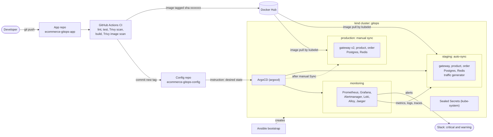

# Capstone 2: GitOps Platform with Monitoring

Three Node.js microservices delivered by a CI pipeline with security gates,
deployed by ArgoCD from Git, and observed with metrics, logs, traces and alerts.

- **Config repo (this one):** Kubernetes config, ArgoCD apps, Ansible, monitoring, docs
- **App repo:** https://github.com/Thormie-Harshey/ecommerce-gitops-app (code, tests, CI)
- **Rebuild it:** [deployment guide](docs/deployment-guide.md)

## Architecture

## How it works

1. A developer pushes code to the app repo.
2. CI runs lint, unit tests and a Trivy scan of libraries and secrets. If any stage fails, the pipeline stops.
3. CI builds each image, scans it with Trivy, pushes it to Docker Hub tagged with the commit ID, then writes that tag into `overlays/staging` in this repo.
4. ArgoCD, inside the cluster, sees Git differ from the cluster and syncs staging. Production waits for a person to click Sync.
5. The kubelet pulls the new image from Docker Hub and starts the pods.
6. Prometheus, Loki and Jaeger collect metrics, logs and traces; Alertmanager posts to Slack.

ArgoCD pulls changes from Git; CI never touches the cluster. Git is the single source of truth.

## Repository layout

| Path | Contents |
|---|---|
| `ansible/` | Bootstrap playbook, inventory, kind cluster config |
| `base/` | One Deployment and Service per component, shared by both environments |
| `overlays/staging`, `overlays/production` | Environment differences: namespace, sealed password, image tags, replicas |
| `argocd/` | Root app (app of apps) and one Application per component |
| `monitoring/` | Helm values, sealed secrets, ServiceMonitor, dashboards, alert rules |
| `docs/` | Deployment guide, runbooks, screenshots |

## Design decisions

| Decision | Choice | Reason |
|---|---|---|
| Repositories | App repo and config repo | Separates code from deployment settings; CI cannot trigger itself |
| Registry | Docker Hub | Named in the brief |
| Cluster | kind on a laptop | No cloud cost or public exposure; Ansible can target a server by changing the inventory |
| Namespaces | staging, production, monitoring, argocd | Isolates environments and tools |
| Services | 3 (gateway, product, order) | Meets the 3+ requirement within a 16 GB laptop |
| Deployment model | Pull-based (ArgoCD) | CI holds no cluster credentials |
| Bootstrapping | Ansible installs only ArgoCD and Sealed Secrets; ArgoCD deploys the rest (app of apps) | Keeps the whole platform in Git |
| Sync policy | Staging: auto-sync, self-heal, prune. Production: manual sync | In ArgoCD, self-heal requires auto-sync; production relies on OutOfSync detection plus human approval |
| Secrets | Sealed Secrets; random password per environment | Encrypted secrets are safe in a public repo |
| Image tags | Commit ID (`sha-xxxxxxx`) | Every image traces to its exact code; tags are never reused |
| Security gates | Trivy scan of libraries and secrets before build, and of the image before push | The image's OS packages exist only after building (defence in depth) |
| Testing | Unit tests with mocks; routes split from start-up (dependency injection) | 21 tests run in about 2 seconds with no database |
| Lint | One ESLint config for all services | One install, one rule set |
| Probes | Readiness on `/health`; liveness on the port only | A database outage stops traffic without restart loops |
| Container security | Non-root, read-only filesystem, no privilege escalation, all capabilities dropped | Applies to the three services |
| Data stores | Postgres StatefulSet with a 1 GB volume; Redis without a volume | Postgres holds data; Redis is a disposable cache |
| Production | 2 gateway replicas | The front door keeps a spare copy |
| Log collector | Alloy instead of Promtail | Promtail is deprecated and end of life; Alloy is its supported replacement |
| Tracing | Jaeger v2, in-memory | Lightest setup for a laptop |
| Traffic generator | Staging only | Production carries no test traffic |
| CI to config repo | Fine-grained token, one repo, contents only, 90-day expiry | Least privilege |
| Versions | All charts and tools pinned | Rebuilds are repeatable |

## Trade-offs and future work

- **Postgres and Redis** run with their images' default security settings, because the official images need root briefly at start-up.
- **Start-up order:** order and product restart a few times while Postgres starts. An init container or retry logic would remove this.
- **Jaeger** keeps traces in memory; they are lost on restart. Production would use Elasticsearch or similar.
- **Single node:** if it fails, alerts cannot be sent. Production would route the Watchdog alert to an external dead man's switch.
- **Sealed Secrets key:** deleting the cluster loses the key, so secrets must be resealed (see the deployment guide). Production would back up the key.
- **prom-client** shows a deprecation notice; it works, and migrating is planned.
- **3 services**, not 5: meets the checklist's minimum, chosen for laptop memory.

## Observability

| Tool | Role |
|---|---|
| Prometheus (kube-prometheus-stack 93.2.0) | Scrapes /metrics from every service every 15 s |
| Grafana | RED (services), USE (node) and logs dashboards, with an Environment selector |
| Loki 7.6.0 and Alloy 1.15.0 | Collect and store logs from every pod |
| Jaeger 4.16.1 (Jaeger v2) | Distributed traces; every log line carries its trace_id |
| Alertmanager | Six rules; critical and warning alerts go to separate Slack channels |

Every alert links to its [runbook](docs/runbooks/).

## Evidence

| Checklist item | Screenshots |
|---|---|
| Pipeline runs on push to main; all stages pass | [07](docs/screenshots/07-ci-pipeline-green.png), [13](docs/screenshots/13-ci-full-pipeline.png) |
| Config repo updated with new image tag | [14](docs/screenshots/14-staging-new-tag.png) |
| Pipeline under 10 minutes (2 to 3 minutes) | [07](docs/screenshots/07-ci-pipeline-green.png), [31](docs/screenshots/31-pipeline-green-after-revert.png) |
| Security gate blocks critical findings | [29](docs/screenshots/29-security-gate-blocked.png), [30](docs/screenshots/30-trivy-critical-finding.png) |
| ArgoCD manages all deployments | [11](docs/screenshots/11-argocd-all-synced.png), [27](docs/screenshots/27-argocd-all-apps.png) |
| Staging auto-syncs, production manual | [10](docs/screenshots/10-argocd-production-waiting.png) |
| Self-heal reverts manual changes | [12](docs/screenshots/12-self-heal.png) |
| Git revert rolls back deployment | [15](docs/screenshots/15-git-revert-rollback.png) |
| Prometheus scraping all targets | [17](docs/screenshots/17-prometheus-targets-up.png), [28](docs/screenshots/28-prometheus-all-targets.png) |
| Grafana dashboards with real data | [18](docs/screenshots/18-grafana-red-dashboard.png), [19](docs/screenshots/19-grafana-use-dashboard.png), [20](docs/screenshots/20-grafana-logs-dashboard.png) |
| Loki collecting logs from all pods | [20](docs/screenshots/20-grafana-logs-dashboard.png) |
| 5+ alert rules; routed to channels | [23](docs/screenshots/23-alert-rules-loaded.png), [24](docs/screenshots/24-alert-firing.png), [25](docs/screenshots/25-slack-critical.png), [26](docs/screenshots/26-slack-resolved.png) |
| 3+ services communicating | [09](docs/screenshots/09-staging-end-to-end.png), [16](docs/screenshots/16-jaeger-trace.png) |
| Structured logging with trace_id | [21](docs/screenshots/21-log-with-trace-id.png), [22](docs/screenshots/22-trace-from-log.png) |
| Unit tests and lint | [01](docs/screenshots/01-order-unit-tests.png), [02](docs/screenshots/02-product-unit-tests.png), [03](docs/screenshots/03-gateway-unit-tests.png), [04](docs/screenshots/04-lint-pass.png) |
| Ansible bootstrap, idempotent | [05](docs/screenshots/05-ansible-first-run.png), [06](docs/screenshots/06-ansible-idempotent-rerun.png) |
